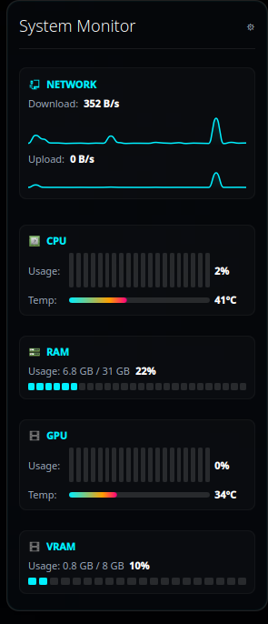

# Modern SysMonitor

A sleek, glassmorphic system monitor widget (plasmoid) for **KDE Plasma 6** featuring real-time resource tracking with a modern Cyberpunk theme.



## Features

- **Network Speed**: Live download/upload speed tracking visualized in smooth, responsive wave area charts.
- **CPU**: Real-time core load displayed in a glowing segmented bar, alongside CPU package temperatures using a smooth horizontal gradient bar.
- **RAM**: Memory utilization (used vs total GB) shown with a 26-segment level bar.
- **GPU (Nvidia)**: Direct utilization and temperature tracking for Nvidia graphics cards (tested on RTX 4060).
- **GPU (AMD)**: Utilization and temperature (junction, falling back to edge) read from `amdgpu` sysfs when `nvidia-smi` is not available. If there is more than one AMD GPU, the one with the most VRAM is used, so a dedicated card wins over an iGPU.
- **VRAM**: GPU memory consumption (Nvidia or AMD).
- **Glassmorphism Design**: Semi-transparent dark background with fine glowing borders, utilizing native Breeze system vector icons (`Kirigami.Icon`).

## Requirements

- **KDE Plasma**: Version 6.0 or higher.
- **GPU sensors**: `nvidia-smi` for Nvidia cards; AMD cards need only the `amdgpu` kernel driver.
- **CPU temperature**: Read from hwmon (`coretemp` on Intel, `k10temp` or `zenpower` on AMD).
- **Python 3**: For running the lightweight, non-blocking stats collection script.

## Installation

1. Clone or download this repository.
2. Open a terminal in the project directory and create a symbolic link to your local plasmoids folder (recommended for development):
   ```bash
   ln -s "$PWD" ~/.local/share/plasma/plasmoids/org.kde.plasma.sysmonitor.modern
   ```
   *Or install it using `kpackagetool6`:*
   ```bash
   kpackagetool6 --type Plasma/Applet --install .
   ```
3. Restart `plasmashell` to load the new widget:
   ```bash
   plasmashell --replace &
   ```
4. Right-click on your Desktop/Panel -> **Add Widgets** -> Search for **Modern SysMonitor** and add it.

## Packaging for KDE Store

To publish this widget on the [KDE Store (store.kde.org)](https://store.kde.org/), you need to bundle it into a `.plasmoid` file (which is a standard ZIP file of the repository):

```bash
zip -r org.kde.plasma.sysmonitor.modern.plasmoid contents metadata.json LICENSE README.md
```

Then, upload the generated `.plasmoid` file to the KDE Store under the **Plasma 6 Widgets** category.

## Security & Best Practices

- **Zero hardcoded credentials**: The script reads only hardware stats and does not use or store any authentication tokens.
- **Local Sandbox**: The temporary state used to calculate delta network/CPU usage is stored securely in `/tmp/sysmonitor_state.json` with user-only permissions.
- **Privacy**: No telemetry, analytics, or external web requests are made.

## License

GPL-2.0-or-later
# kde_plasma_widgets
